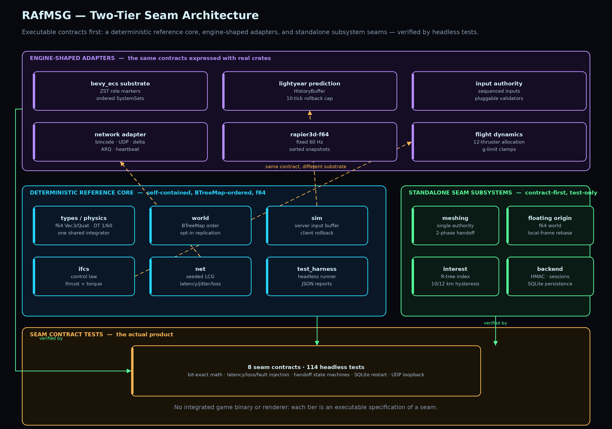

# RAfMSG — Design Decisions

Scope: this crate is a **reference architecture**, not a shipped game. The decisions below are reconstructed from the code and its tests; the source modules deliberately carry no prose comments. Each entry gives the decision, why it was made, the tradeoff accepted, and the code that pins it down.

*Editable source: [architecture.drawio](docs/diagrams/architecture.drawio)*

## Principles

1. **Determinism is structural, not incidental.** Fixed timestep, ordered containers, f64 math, and a single integrator make replay reproducible by construction.
2. **Contracts before integration.** Each subsystem is specified and tested at its seam before being wired into a larger loop.
3. **One invariant, two implementations.** The reference core and the engine-shaped adapters express the same contract with different substrates; both are tested.
4. **Authority fails closed.** Unowned entities, stale sequences, unregistered components, and out-of-order snapshots are rejected rather than guessed.
5. **Headless by default.** Every test runs without a display, renderer, or external service.
6. **Limits are explicit.** Epsilons, rollback caps, history sizes, rate limits, hysteresis bands, and thresholds are named constants, not magic numbers buried in control flow.
7. **Gaps are recorded, not hidden.** Reserved enum states, placeholder templates, and security hardening needs are listed at the end.

## A. Foundations

### DD-001 — Fixed 60 Hz logical clock, f64 throughout
**Decision:** `TICK_HZ = 60`, `DT = 1/60` as f64; no variable-dt accumulator.
**Why:** one global step makes replay and cross-machine comparison exact.
**Tradeoff:** simulation time cannot be scaled without changing the contract.
**Code:** `src/types.rs:7-8`, `src/physics.rs:16-19`, `src/physics3d.rs:11`.

### DD-002 — Ordered containers everywhere
**Decision:** entity stores, input buffers, shadows and snapshots use `BTreeMap`/`BTreeSet`, not hash containers.
**Why:** deterministic iteration yields byte-stable snapshots and identical replay order.
**Tradeoff:** O(log n) lookups instead of O(1).
**Code:** `src/world.rs:25-53`, `src/physics3d.rs:161-169`, `src/meshing.rs:120-130`, `src/backend.rs:91-112`.

### DD-003 — One body and input vocabulary
**Decision:** `ShipBody` (pos, vel, ori, ang_vel, mass), `ShipInput` (four axes in [-1, 1]), and `ForceTorque` are shared by every tier; `inv_mass()` is zero for non-positive mass, which is the static-body convention.
**Why:** a single POD contract keeps the seams composable and makes bridge tests possible.
**Tradeoff:** no inertia tensor or shape in the reference body; richer state lives in Rapier.
**Code:** `src/types.rs:162-228`, `src/ecs.rs:9-13`.

### DD-004 — Two named convergence tolerances
**Decision:** `POS_EPS = 0.01`, `ORI_EPS = 0.001`.
**Why:** one shared definition of "close enough" for reconciliation and tests.
**Tradeoff:** the adapter tier duplicates these values in a config struct instead of importing them.
**Code:** `src/types.rs:9-10`, `src/prediction.rs:8-27`, `src/sim.rs:166-167`.

## B. Authority and replication

### DD-005 — Replication is opt-in; hidden state never leaves
**Decision:** only entities with `replicate = true` enter a snapshot; `server_only` data is never serialized. Clients create unknown entities from snapshots with `authority = None`.
**Why:** minimizes what a client can see and prevents hidden state from leaking.
**Tradeoff:** clients cannot infer ownership from the wire format.
**Code:** `src/world.rs:4-23`, `src/world.rs:67-94`, `tests/seam1_replication.rs:43-57`.

### DD-006 — Ownership enforced at two gates
**Decision:** ownership is checked on input submission and again on any direct client mutation of the world.
**Why:** defense in depth at the ingress seam and the state seam.
**Tradeoff:** two places to keep in sync; `AuthorityError::StaleTick` is reserved but not yet returned.
**Code:** `src/sim.rs:38-48`, `src/world.rs:96-117`, `tests/seam2_authority.rs:28-40`.

### DD-007 — Hold last input on packet loss
**Decision:** the first input received for an entity in a tick wins; if none arrives, the previous input is reused.
**Why:** a dropped control packet should not read as "stop" or cause runaway motion.
**Tradeoff:** duplicate same-tick inputs from an owner are silently ignored.
**Code:** `src/sim.rs:52-66`, `src/input.rs:68-129`, `tests/seam2_authority.rs:42-72`.

### DD-008 — Monotonic snapshot guard
**Decision:** snapshots at or below the last accepted tick are dropped and counted.
**Why:** jitter-induced reordering must not roll a client backwards.
**Tradeoff:** depends on tick monotonicity rather than an explicit snapshot sequence number.
**Code:** `src/sim.rs:131-139`, `src/prediction.rs:189-193`.

### DD-009 — Replication rules fail closed
**Decision:** unregistered components default to `SyncMode::None`; per-client `Once` delivery is deduplicated; rate is expressed as "every N ticks" with N clamped to at least 1.
**Why:** nothing new is replicated until it is explicitly registered.
**Tradeoff:** rate control is tick-based, not bandwidth-based.
**Code:** `src/network.rs:25-57`, `src/network.rs:367-438`.

## C. Prediction and time

### DD-010 — One integrator for every tier
**Decision:** server, reference client, prediction client, flight controller and floating-origin world all call `crate::physics::advance` / `step`.
**Why:** a shared semi-implicit Euler step is what makes bit-exact replay achievable.
**Tradeoff:** the reference integrator is simple — no inertia tensor, no constraint solver.
**Code:** `src/physics.rs:4-19`, `src/sim.rs:61`, `src/flight.rs:175-178`.

### DD-011 — Two reconciliation tiers with the same invariants
**Decision:** `sim::Client` uses plain maps and unbounded history; `prediction::PredictionClient` uses lightyear `HistoryBuffer`, marker components and bounded replay. Both replay from `snapshot.tick + 1` and compare against the same epsilons.
**Why:** one tier proves the math exactly, the other demonstrates the engine-shaped version.
**Tradeoff:** duplicated replay logic that must be kept semantically aligned.
**Code:** `src/sim.rs:74-185`, `src/prediction.rs:108-247`, `tests/prediction_reconciliation.rs:142-162`.

### DD-012 — Bound the adapter's CPU work
**Decision:** adapter rollback is capped at 10 ticks, history at 32 ticks, interpolation pruning at delay + 8.
**Why:** a very stale snapshot must not cause unbounded replay in a live client.
**Tradeoff:** after a severe stall the client accepts authoritative state without replaying.
**Code:** `src/prediction.rs:8-27`, `src/prediction.rs:29-55`, `src/prediction.rs:161-229`.

### DD-013 — Interpolation delay with component-wise lerp
**Decision:** remote bodies are rendered 6 ticks behind, with normalized component-wise lerp for orientation rather than slerp.
**Why:** cheap, stable smoothing for small deltas.
**Tradeoff:** angular speed is not constant for large orientation changes.
**Code:** `src/prediction.rs:29-106`.

### DD-014 — Fault injection is a first-class input
**Decision:** the mock network models latency, jitter and loss with a seeded platform-independent LCG; the headless runner can inject a `+5.0` position fault at a chosen tick.
**Why:** convergence must be proven under bad network conditions and deliberate divergence, not just in the happy path.
**Tradeoff:** the custom LCG and the harness's `StdRng` are two different RNG strategies.
**Code:** `src/net.rs:6-51`, `src/net.rs:84-111`, `src/test_harness.rs:184-245`, `tests/test_harness.rs:52-115`.

## D. Network adapter

### DD-015 — Flat f64 wire body, angular velocity omitted
**Decision:** `WireBody` is 11 serde-encoded f64 fields; conversion resets `ang_vel` to zero.
**Why:** a compact, stable binary contract that is easy to delta-compress.
**Tradeoff:** angular state is not replicated on this seam.
**Code:** `src/network.rs:59-102`.

### DD-016 — Deltas and measured compression
**Decision:** snapshots have a separate `Delta` form (changed + removed), and `BandwidthProfiler` records raw versus encoded bytes.
**Why:** compression claims are measured in tests, not assumed.
**Tradeoff:** delta equality checks the whole body, so any field change resends the full entry.
**Code:** `src/network.rs:120-189`, `src/network.rs:440-470`, `tests/networking_layer.rs:104-150`.

### DD-017 — One transport trait, two implementations
**Decision:** `MemoryTransport` for deterministic tests and `UdpTransport` for real loopback traffic share the `Transport` interface.
**Why:** higher layers are testable without sockets.
**Tradeoff:** unknown UDP peers currently map to a single client id, and the channel hint is not carried on the wire.
**Code:** `src/network.rs:191-281`, `tests/networking_layer.rs:40-60`, `tests/networking_layer.rs:179-192`.

### DD-018 — Reliability and liveness above the transport
**Decision:** `ReliableQueue` adds explicit sequence numbers, ACKs and retransmission; `Connection` uses heartbeats with a 5-tick timeout.
**Why:** keeps the transport dumb and the policy inspectable.
**Tradeoff:** retransmission re-sends every unacked message; there is no sliding window or timeout on the queue itself.
**Code:** `src/network.rs:283-365`, `tests/networking_layer.rs:152-177`.

## E. Engine substrates

### DD-019 — Roles as zero-sized components, schedule as explicit chain
**Decision:** `Server`, `OwnedBy`, `Replicate`, `Predicted`, `Interpolated` are marker components; lifecycle sets are chained in a fixed order.
**Why:** network and ownership roles become compile-time query filters and the schedule is reproducible.
**Tradeoff:** the role vocabulary is fixed, and the demo systems use hardcoded tick gates and throttle.
**Code:** `src/ecs.rs:9-45`, `src/ecs.rs:157-212`.

### DD-020 — Rapier f64 at a fixed step, snapshots sorted by handle
**Decision:** `rapier3d-f64`, zero-gravity default, `PHYSICS_DT = 1/60`, collision events opt-in, snapshots sorted by handle.
**Why:** makes physics bit-exact across identical worlds and keeps per-collider overhead off by default.
**Tradeoff:** handles, not entity ids, are the snapshot key; Rapier is not connected to the reference world.
**Code:** `src/physics3d.rs:7-28`, `src/physics3d.rs:38-55`, `src/physics3d.rs:94-169`, `tests/physics_integration.rs:104-151`.

### DD-021 — Thruster wrench plus least-squares allocation
**Decision:** each thruster contributes force and `cross(position, force)` torque; a 6×N matrix is solved with a pseudoinverse (tolerance 1e-9) and throttles clamped to [0, 1].
**Why:** a generic 6-DOF rig can be allocated without hand-tuned mixing.
**Tradeoff:** matrix solve per frame, unidirectional thrusters, and silent saturation for unreachable requests.
**Code:** `src/flight.rs:13-87`, `tests/flight_dynamics.rs:97-155`.

### DD-022 — Safety limits live in the control law
**Decision:** axes are clamped to [-1, 1], thrust is mass-scaled and g-limited, torque is clamped, and damping is applied linearly.
**Why:** untrusted input cannot request unbounded acceleration from the simulation.
**Tradeoff:** `FlightTuning` duplicates and extends `IfcsConfig`; the two control laws are parallel implementations.
**Code:** `src/ifcs.rs:3-41`, `src/flight.rs:101-172`, `tests/seam4_ifcs.rs:39-60`.

## F. Subsystem seams

### DD-023 — Floating origin: f64 world, local-frame simulation
**Decision:** world coordinates are f64; bodies simulate near the origin; a camera move beyond 1000 units rebases the anchor and subtracts the delta from every local position.
**Why:** avoids f32 quantization at large distances while preserving world positions exactly across a rebase.
**Tradeoff:** only position is frame-relative; velocity and orientation are frame-invariant. Relative positions are not yet fed into the wire format.
**Code:** `src/floating_origin.rs:7`, `src/floating_origin.rs:50-148`, `tests/floating_origin.rs:29-58`.

### DD-024 — Interest: two ranges and debounced eviction
**Decision:** enter at 10 km, exit at 12 km, evaluate every 10 ticks, drop after 2 consecutive misses; an R-tree indexes positions.
**Why:** the hysteresis band prevents flicker at the sensor boundary, and debouncing prevents a single missed update from hiding an entity.
**Tradeoff:** position changes rebuild the index; leaving view does not mean the entity is destroyed.
**Code:** `src/interest.rs:5-22`, `src/interest.rs:79-165`, `tests/interest_management.rs:19-140`.

### DD-025 — Meshing: generation-guarded two-phase handoff
**Decision:** one authority per entity plus read-only shadows; handoff moves through `Preparing → AwaitingAck → Committed`, mints a token, increments a generation, and only flips authority at commit. Least-loaded assignment breaks ties by server id.
**Why:** stale or out-of-order handoff messages cannot silently steal an entity.
**Tradeoff:** leases are unsigned and tokens are predictable; the coordinator's `assign()` and `spawn()` are separate calls.
**Code:** `src/meshing.rs:17-34`, `src/meshing.rs:60-109`, `src/meshing.rs:184-309`, `tests/server_meshing.rs:41-109`.

### DD-026 — Backend: HMAC tokens, sessions, parameterized SQL
**Decision:** HMAC-SHA256 tokens over a user name; in-memory session manager with first-fit matchmaking; ship state stored as JSON in a SQLite table using parameterized upserts.
**Why:** demonstrates an authenticated service seam with restart-safe persistence and no SQL injection surface.
**Tradeoff:** tokens have no expiry and use a non-constant-time compare; session ids are counter-derived; `persist`/`reconnect` take a raw user string without a token check.
**Code:** `src/backend.rs:31-62`, `src/backend.rs:84-178`, `src/backend.rs:212-310`, `tests/backend_services.rs:8-136`.

### DD-027 — Input authority: layered validation with pluggable hooks
**Decision:** an `AntiCheatHook` trait is injected into a validator that checks ownership, finite values and axis range, hooks, rate limits, then buffers.
**Why:** validation policy can change without rewriting the ingest path.
**Tradeoff:** the configured rate window is 10 ticks despite the `max_per_tick` field name, and hook rejection collapses the specific reason.
**Code:** `src/input.rs:172-238`, `tests/input_authority.rs:127-164`.

## G. Test strategy

### DD-028 — Eight named seams, real behavioral suites
**Decision:** every seam has a reserved id and a named test module; seams 1–4 also have dedicated `seamN_*.rs` contract files.
**Why:** the seam list is the architecture's table of contents and makes missing coverage visible.
**Tradeoff:** `seam_templates()` currently emits no-op passing entries for seams 5–8; their real coverage is in the subsystem test files.
**Code:** `src/test_harness.rs:129-173`, `tests/`, `tests/test_harness.rs:42-50`.

### DD-029 — Portable, inspectable reports
**Decision:** `TestReport` / `TestRunner` collect named outcomes and serialize to JSON; `DeterminismChecker` offers bit-exact, epsilon and position comparisons.
**Why:** results can be consumed outside `cargo test` and compared with the right notion of equality.
**Tradeoff:** failure reasons are free-form strings, not structured diagnostics.
**Code:** `src/test_harness.rs:10-97`, `tests/test_harness.rs:5-40`.

### DD-030 — Strict CI gates
**Decision:** `cargo fmt --check`, `cargo clippy --all-targets -- -D warnings`, and `cargo test --all-targets`.
**Why:** formatting, lint and test regressions are caught at the same point.
**Code:** `.github/workflows/ci.yml:17-22`.

## H. Deferred work and known limits

These are deliberate gaps in the reference architecture, not defects in the implemented contracts.

| Area | Current limit | Code |
|---|---|---|
| Runtime integration | no binary, renderer or unified loop; world, ECS, Rapier, origin, meshing and backend worlds are parallel | `src/lib.rs:1-17` |
| Message shapes | three input message types and three body/snapshot representations with no conversions between them | `src/sim.rs:7-13`, `src/network.rs:59-118`, `src/input.rs:14-56` |
| Identity | backend users (`String`) are not mapped to game `ClientId` (`u64`), so auth cannot gate in-world actions | `src/backend.rs:65-76`, `src/types.rs:3-5` |
| Control law | `FlightTuning` and `IfcsConfig` duplicate control parameters | `src/flight.rs:101-122`, `src/ifcs.rs:3-20` |
| Wire fidelity | angular velocity is dropped by `WireBody`; floating-origin relative positions do not reach the network seam | `src/network.rs:59-102`, `src/floating_origin.rs:146-148` |
| Authorization hooks | interest visibility and meshing authority are not consulted by the main sim/network path | `src/interest.rs:150-165`, `src/meshing.rs:184-202` |
| Reserved states | `AuthorityError::StaleTick` and `ConnectionState::Connecting` are declared but never produced | `src/world.rs:96-100`, `src/network.rs:319-322` |
| Security hardening | non-constant-time token compare, no token expiry, predictable session ids, unsigned leases, unauthenticated persistence | `src/backend.rs:43-89`, `src/backend.rs:304-310`, `src/meshing.rs:17-23` |
| Harness coverage | cross-seam templates are placeholders | `src/test_harness.rs:167-173` |

## Related documents

- [README.md](README.md) — overview, seam table, build commands and status.
- [DEVELOPER_GUIDE.md](DEVELOPER_GUIDE.md) — contributor workflow, conventions and testing recipes ([PDF](DEVELOPER_GUIDE.pdf)).
- `docs/diagrams/*.drawio` — editable diagram sources.
- `docs/diagrams/render.py` — regenerates the PNG exports from the same layout definitions.
