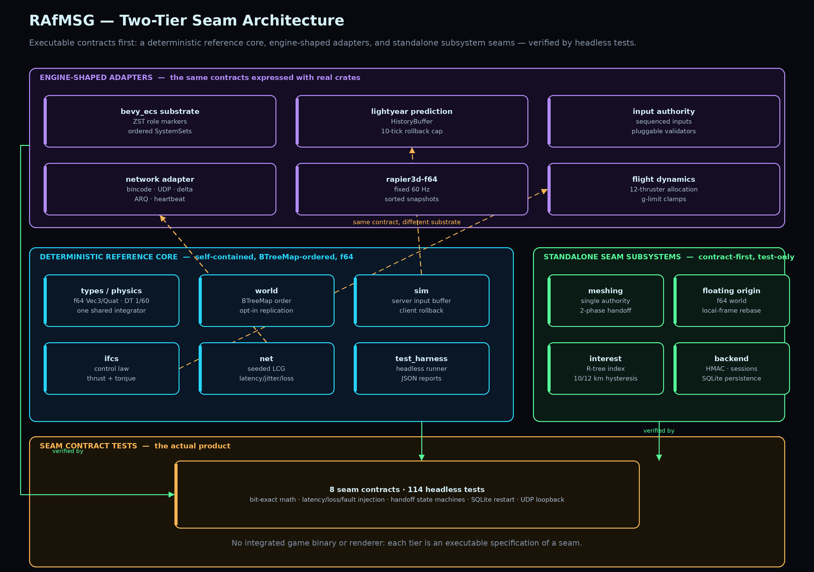

# RAfMSG Developer Guide

> **Status: draft scaffold.** This guide captures the conventions that are already visible in the code. Sections marked *Planned* are intentional placeholders for decisions the project has not made yet.

RAfMSG is a reference architecture: a set of seam contracts with deterministic tests. This guide is for contributors changing the contracts, the reference core, the engine-shaped adapters, the standalone subsystem seams, or the documentation. For the *why* behind the code, read [DESIGN_DECISIONS.md](DESIGN_DECISIONS.md); for the *what*, start with [README.md](README.md).



*Editable diagram source: [architecture.drawio](docs/diagrams/architecture.drawio).*

## 1. Quick start

Prerequisites: Rust stable (edition 2021), Git, and `cargo`. Diagram work additionally needs Python 3 with Pillow and a draw.io editor; no game assets, display, or external services are required to build or test.

```sh
git clone https://github.com/CryptoJones/RAfMSG.git
cd RAfMSG
cargo test
cargo fmt --all -- --check
cargo clippy --all-targets -- -D warnings
```

These three commands are the same gates run by `.github/workflows/ci.yml` on every pull request. A change is not done until all three are clean locally.

## 2. Repository map

| Path | Contents |
|---|---|
| `src/lib.rs` | Public surface; every module is exported here |
| `src/types.rs`, `src/physics.rs`, `src/ifcs.rs` | Shared math, integrator and control law |
| `src/world.rs`, `src/sim.rs`, `src/net.rs` | Deterministic reference core: world, client/server loop, fault-injecting network |
| `src/ecs.rs`, `src/physics3d.rs`, `src/prediction.rs`, `src/input.rs`, `src/network.rs` | Engine-shaped adapters using bevy_ecs, Rapier, Lightyear, bevy_input, bincode/UDP |
| `src/meshing.rs`, `src/floating_origin.rs`, `src/interest.rs`, `src/backend.rs` | Standalone subsystem seams |
| `src/test_harness.rs` | Headless runner, report types, determinism checkers, seeded inputs |
| `tests/` | Integration tests, grouped by seam plus substrate suites |
| `docs/diagrams/` | Editable draw.io sources, PNG exports, and `render.py` |
| `README.md`, `DESIGN_DECISIONS.md` | Orientation record and decision record |

## 3. Architecture orientation

The crate has three groups, described in detail in the README and decision record:

1. **Deterministic reference core** — proves contracts exactly with fixed timestep, ordered maps and f64 math.
2. **Engine-shaped adapters** — express the same contracts with real crates.
3. **Standalone subsystem seams** — independently tested subsystem contracts.

They are **not** one integrated runtime. When you change a shared type or invariant, check both tiers and every subsystem test that depends on it.

## 4. Invariants to preserve

These are the load-bearing rules. Breaking one requires a corresponding decision entry and test update.

- One logical clock: `TICK_HZ = 60`, `DT = 1/60` in `src/types.rs`.
- Deterministic ordering: use `BTreeMap`/`BTreeSet` for state that is snapshotted, replayed or serialized.
- One integrator: all simulation paths call `crate::physics::advance` / `step`.
- Shared vocabulary: `ShipBody`, `ShipInput` and `ForceTorque` are the contract types.
- Opt-in replication: `replicate = true`; `server_only` state never crosses the wire.
- Authority is checked at ingress and at mutation; stale snapshots and stale sequences are rejected.
- Network faults are seeded and reproducible; tests must not depend on wall-clock timing or real sockets unless they exercise the UDP adapter.
- Convergence is measured with `POS_EPS = 0.01` and `ORI_EPS = 0.001` (or the adapter's configurable equivalents).

## 5. Development workflow

1. Create a topic branch from `main`: `feat/<seam>`, `fix/<area>`, or `docs/<topic>`.
2. Keep commits focused and use the existing style: `feat(scope): ...`, `fix(scope): ...`, `docs: ...`.
3. Run the three gates from section 1 before pushing.
4. Open a pull request against `main` and describe the contract change, not just the implementation.
5. CI must pass before merge. The repository's history uses merge commits.
6. Update the documentation in the same change when behavior, invariants or module boundaries change.

## 6. Adding or changing a seam

A checklist for a new seam or a material change to an existing one:

1. Reserve a `SeamId` and its display name in `src/test_harness.rs`.
2. Write down the input surface, invariants and tradeoff in `DESIGN_DECISIONS.md` before implementing.
3. Implement the module in `src/` and export it from `src/lib.rs`.
4. Add an integration test file in `tests/` that exercises the invariants, not just the happy path.
5. Add the seam to the table in `README.md`.
6. Regenerate the seam-map diagram (section 8) if the seam list changes.
7. Run all three gates and confirm the new tests appear in `cargo test` output.

For changes to an existing seam, keep its public input surface stable or update every caller and its decision entry together.

## 7. Testing guide

Test layers, from narrowest to widest:

| Layer | Examples | What it proves |
|---|---|---|
| Contract invariants | `tests/seam1_replication.rs` … `tests/seam4_ifcs.rs` | A seam enforces its stated rules |
| Reference network | `tests/mock_network.rs` | Latency, jitter, loss and reordering behave deterministically |
| Adapter behavior | `tests/networking_layer.rs`, `tests/prediction_reconciliation.rs`, `tests/input_authority.rs` | Engine-shaped implementations satisfy the same contracts |
| Subsystem seams | `tests/server_meshing.rs`, `tests/floating_origin.rs`, `tests/interest_management.rs`, `tests/backend_services.rs` | Standalone subsystem contracts hold |
| End-to-end harness | `tests/test_harness.rs` | Headless run converges under seeded faults |

Useful commands:

```sh
cargo test                          # everything
cargo test --test seam1_replication # one integration suite
cargo test harness_headless         # one test by name filter
cargo test -- --nocapture           # show println! output
```

When adding a determinism test, prefer bit-exact comparison for integers, ids and Rapier state, and epsilon comparison only for floating-point results that legitimately accumulate error. The reference network's LCG is seeded: assert a specific drop/delay pattern rather than a probabilistic outcome.

## 8. Diagrams and documentation

The PNGs in `docs/diagrams/` are generated from the layout definitions in `render.py`; the matching `.drawio` files are editable sources kept alongside them.

```sh
python3 -m pip install Pillow
python3 docs/diagrams/render.py
```

If you add a box to a diagram, change it in `render.py`, regenerate the PNG, and update the `.drawio` source so the two stay in sync.

| Document | Update it when |
|---|---|
| `README.md` | Seam list, module map, build commands or project status change |
| `DESIGN_DECISIONS.md` | A tradeoff, invariant or deferred item changes |
| This guide | Workflow, conventions, test strategy or diagram tooling changes |

The source modules intentionally carry no inline comments. Put rationale in the decision record so it stays reviewable and versioned.

## 9. Security and authority notes

Authorization is enforced at several independent seams: world ownership, input validation, replication rules, interest visibility, meshing handoff state and backend tokens. When touching any of these, verify the rejection path as well as the success path in tests.

Known hardening items are listed in the deferred-work table of `DESIGN_DECISIONS.md`. Do not treat the current reference implementations as production-ready security controls.

## 10. Debugging recipes

- **A convergence test fails intermittently:** check that all randomness comes from the seeded `net::Lcg` or `SeededInputs`; wall-clock or hash-map iteration order is the usual cause.
- **Snapshots look stale:** inspect the monotonic tick guard in `src/sim.rs` and `src/prediction.rs`; snapshots at or below the last accepted tick are intentionally ignored.
- **A client cannot mutate an entity:** confirm the entity's `authority` matches the submitting client at both `sim::Server::submit_input` and `world::try_client_mutate`.
- **Physics diverges:** confirm both worlds use the same timestep and that Rapier snapshots are sorted by handle before comparison.
- **A diagram fails to render:** regenerate with `python3 docs/diagrams/render.py` and verify the PNG files are committed.

## 11. Planned additions

This scaffold is deliberately incomplete. The following sections should be filled in when the project makes the corresponding decisions:

- Release and versioning policy for the crate.
- Code ownership and review rotation.
- Integrated-runtime onboarding (how to run the unified loop once one exists).
- Performance budget and profiling workflow.
- Backend service deployment and secret management.
- Shared identity mapping between authenticated users and `ClientId`.

## 12. Glossary

| Term | Meaning |
|---|---|
| Seam | A bounded interface with an input surface, invariants and tests |
| Reference core | Self-contained deterministic implementation of a contract |
| Adapter | Implementation of the same contract using engine or transport crates |
| World | Entity store with snapshots and authority metadata |
| Snapshot | State of all replicable entities at one tick |
| Prediction | Local simulation of owned entities ahead of authoritative state |
| Reconciliation | Replay of buffered inputs after an authoritative snapshot arrives |
| Lease | A meshing record assigning authority for one entity to one server |
| Rebase | Moving the floating-origin anchor without changing world positions |
| Hysteresis | Two thresholds used to prevent visibility flicker at a boundary |
