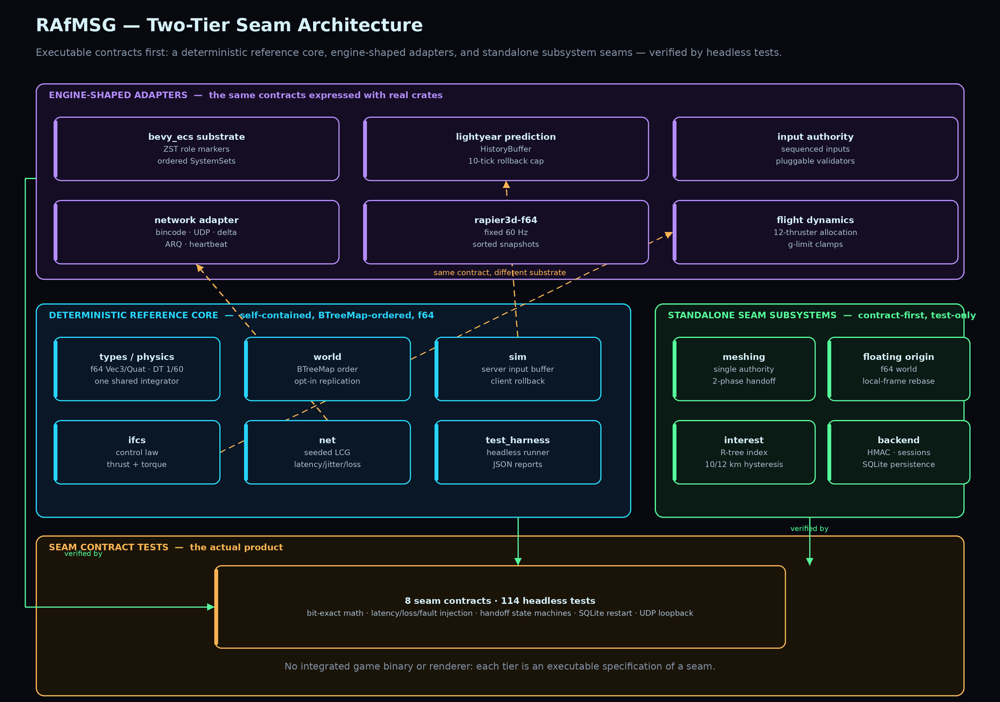
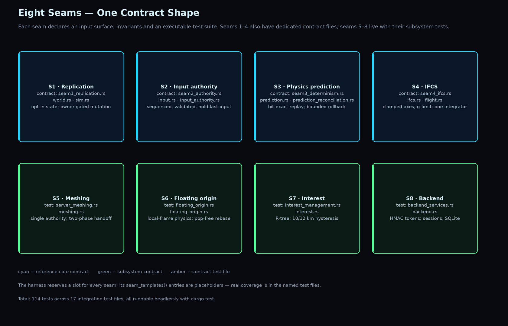
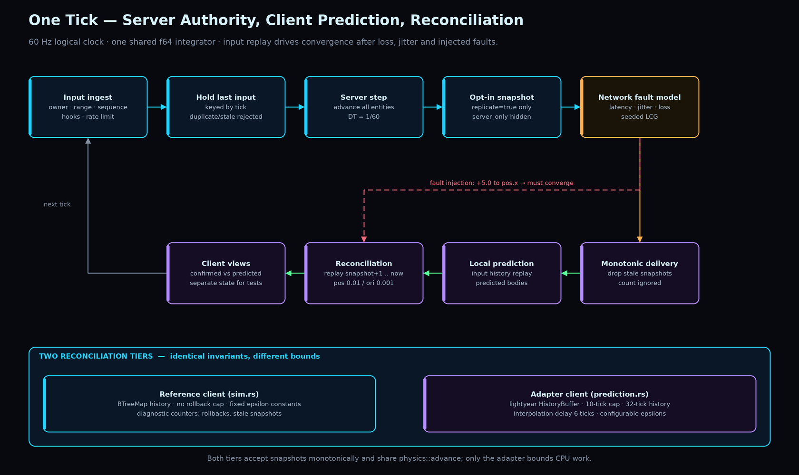

# RAfMSG

> Reference architecture glue for a multiplayer space game: seam contracts and headless tests.

RAfMSG is an **executable specification**, not a game. It defines the interfaces — the *seams* — between the subsystems a networked space game needs, and proves each seam with deterministic, headless tests. There is no renderer, no binary, and no gameplay loop by design.



*Editable source: [architecture.drawio](docs/diagrams/architecture.drawio)*

## What is a seam?

A seam is a bounded interface with three parts: an **input surface**, a set of **invariants**, and an **executable test suite**. Eight seams are named in `src/test_harness.rs:129`:

| # | Seam | Contract tests |
|---|---|---|
| 1 | Replication | `tests/seam1_replication.rs`, `tests/mock_network.rs` |
| 2 | Input authority | `tests/seam2_authority.rs`, `tests/input_authority.rs` |
| 3 | Physics / prediction | `tests/seam3_determinism.rs`, `tests/prediction_reconciliation.rs` |
| 4 | IFCS | `tests/seam4_ifcs.rs`, `tests/flight_dynamics.rs` |
| 5 | Server meshing | `tests/server_meshing.rs` |
| 6 | Floating origin | `tests/floating_origin.rs` |
| 7 | Interest management | `tests/interest_management.rs` |
| 8 | Backend services | `tests/backend_services.rs` |



*Editable source: [seam-map.drawio](docs/diagrams/seam-map.drawio)*

## Two tiers, one contract

The same invariants are expressed twice: once in a self-contained deterministic core, once with the crates a real engine would use.

| Tier | Purpose | Modules |
|---|---|---|
| Deterministic reference core | Prove the contract exactly: fixed timestep, ordered maps, f64, no engine deps | `types`, `physics`, `ifcs`, `world`, `sim`, `net`, `test_harness` |
| Engine-shaped adapters | Show the contract against real libraries | `ecs` (bevy_ecs), `physics3d` (rapier3d-f64), `prediction` (lightyear), `input` (bevy_input), `network` (bincode/UDP) |
| Standalone subsystem seams | Contract-first implementations that are tested independently | `meshing`, `floating_origin`, `interest`, `backend` |

The tiers share `types.rs` and `physics.rs`. They are **not** yet a single runtime pipeline; integration is the main deferred work.

## One tick



*Editable source: [tick-lifecycle.drawio](docs/diagrams/tick-lifecycle.drawio)*

Authority stays on the server; the client predicts and reconciles. Loss and jitter are injected by a seeded reference network, and a deliberate position fault is used to prove convergence. The reference client replays without a cap; the adapter client bounds replay to 10 ticks and history to 32.

## Design decisions

Every box in the diagrams corresponds to a recorded decision with its rationale, tradeoff and code location: [DESIGN_DECISIONS.md](DESIGN_DECISIONS.md).

## Developer guide

Conventions, workflow, testing recipes and diagram instructions: [DEVELOPER_GUIDE.md](DEVELOPER_GUIDE.md) ([PDF](DEVELOPER_GUIDE.pdf)).

## Build and verify

Rust stable, edition 2021. No network services, display, or game assets are needed.

```sh
cargo test                              # 114 tests, all headless
cargo fmt --all -- --check
cargo clippy --all-targets -- -D warnings
```

The same three gates are configured in `.github/workflows/ci.yml`.

## Repository layout

```text
src/                 17 library modules plus lib.rs, one per subsystem or substrate
tests/               17 integration test files, grouped by seam
docs/diagrams/       editable draw.io sources, PNG exports, and render.py
DEVELOPER_GUIDE.*    contributor workflow and conventions (Markdown + PDF)
Cargo.toml           crate definition and pinned dependency versions
```

## Status

- **Done:** all eight seams implemented; 114 passing tests; strict CI gates; reproducible fault injection and headless runner.
- **In progress:** the cross-seam harness (`src/test_harness.rs`) lists every seam as skipped. Behavioral coverage stays in the per-seam test files.
- **Deferred:** a single integrated runtime (ECS ↔ physics ↔ network ↔ origin ↔ interest ↔ backend), a shared identity between backend users and `ClientId`, and the hardening items listed in `DESIGN_DECISIONS.md`.

## Diagram sources

PNG exports are generated from `docs/diagrams/render.py` (requires Pillow). Each diagram also ships as a `.drawio` file that can be opened and edited in draw.io; the PNGs are checked in so they render on GitHub without tooling.
